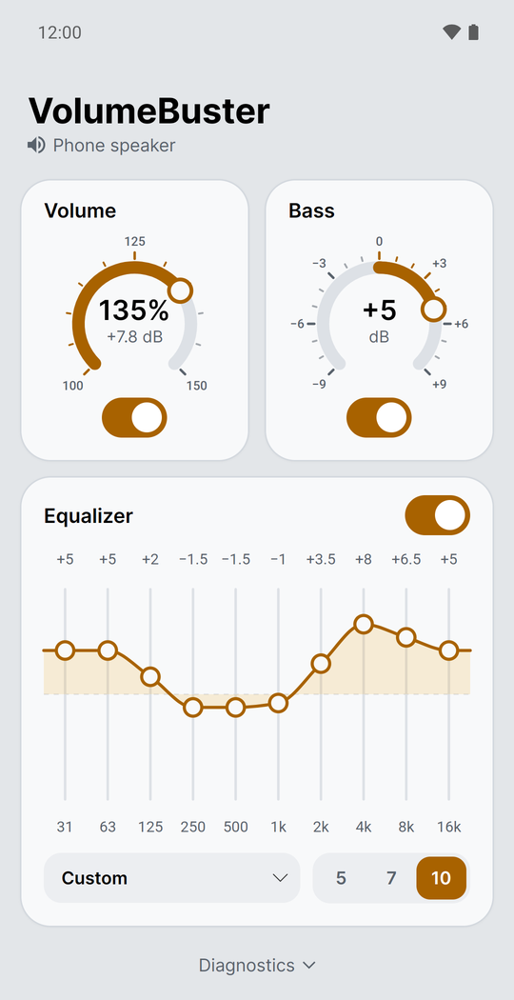
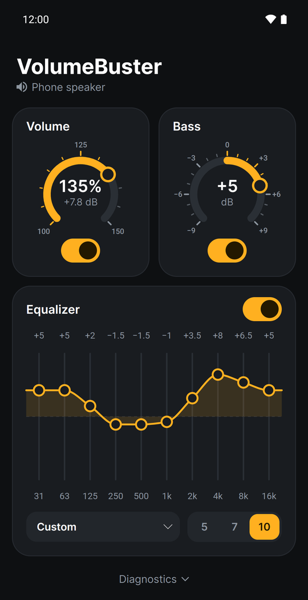

# VolumeBuster

Android volume booster above 100% for all apps, no root. Boost up to +10 dB, bass and equalizer.

<p align="center">
  
  
</p>

## Build

Requires .NET SDK 10 with the `android` workload, Android SDK 36 and JDK 21.

```bash
cd src
dotnet test VolumeBuster.Tests
dotnet publish VolumeBuster.Android -c Release
```

## License

[MIT](LICENSE)
